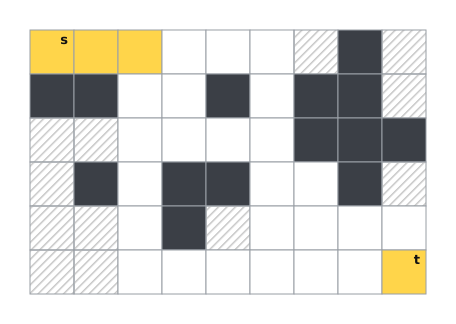
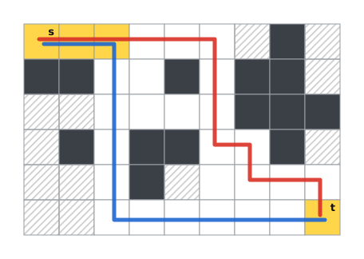
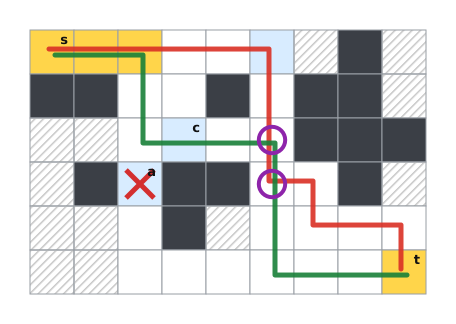
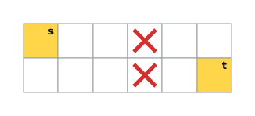

<p class="subtitle">از ایده‌های ساده تا راه‌حل خطی، همراه با راهنمایی‌های پله‌پله</p>

## مسئله در یک نگاه

جدولی $n \times m$ داریم که بعضی خانه‌هایش مسدودند. از $(1,1)$ به $(n,m)$ فقط با حرکت به **پایین** یا **راست** و فقط روی خانه‌های آزاد می‌رویم. باید بشماریم به چند روش می‌توان **دو خانهٔ آزاد متفاوت** را مسدود کرد تا دیگر هیچ مسیری باقی نماند. ابعاد جدول تا $3000 \times 3000$ است، یعنی تا نُه میلیون خانه.

::: roadmap
**نقشهٔ راه**

| زیرمسئله | امتیاز | محدودیت | ایدهٔ کلیدی | پیچیدگی |
|:-:|:-:|:-:|:-:|:-:|
| ۱ | ۸ | جدول کاملاً آزاد | فرمول بسته | $O(nm)$ برای خواندن |
| ۲ | ۱۲ | $n,m \le 15$ | امتحان همهٔ جفت‌ها | $O((nm)^3)$ |
| ۳ | ۱۵ | $n,m \le 50$ | یک خانه را ثابت کن، خانه‌های «تنها» را بشمار | $O((nm)^2)$ |
| ۴ | ۲۵ | $n,m \le 300$ | فقط خانه‌های مسیر چپ را ثابت کن | $O((n+m)\cdot nm)$ |
| ۵ | ۴۰ | $n,m \le 3000$ | مسیر چپ جدید را سریع بساز | $O((n+m)^2)$ یا $O(nm)$ |
:::

این ادیتوریال دو بخش اصلی دارد. در **بخش اول** فقط راهنمایی‌ها آمده‌اند، از ساده به سخت. پیشنهاد می‌کنیم بعد از خواندن هر راهنمایی کمی فکر کنید و فقط اگر گیر کردید سراغ راهنمایی بعدی بروید. در **بخش دوم** راه‌حل کامل، اثبات‌ها، راه‌حل هر زیرمسئله، دام‌های رایج و کد آمده است.

<div class="pb"></div>

# بخش اول: راهنمایی‌ها

::: hint
**راهنمایی ۱ — حالت بدیهی.**
اگر از همان اول هیچ مسیری وجود نداشته باشد، پاسخ چیست؟ تعداد خانه‌های آزاد را $F$ بنامید.
:::

::: hint
**راهنمایی ۲ — قطرهای فرعی.**
خانه‌هایی را که $i+j$ آن‌ها برابر است یک «قطر» بنامید. هر حرکت به پایین یا راست، مقدار $i+j$ را دقیقاً یکی زیاد می‌کند. هر مسیر از هر قطر چند خانه را می‌بیند؟
:::

::: hint
**راهنمایی ۳ — خانه‌های مهم.**
همهٔ خانه‌های آزاد مهم نیستند. خانه‌ای که از $(1,1)$ به آن نمی‌رسیم، یا از آن به $(n,m)$ نمی‌رسیم، روی هیچ مسیری نیست. با دو برنامه‌ریزی پویای ساده خانه‌هایی را پیدا کنید که روی دست‌کم یک مسیر قرار دارند. اسم این‌ها را **خانه‌های مفید** بگذارید.
:::

::: hint
**راهنمایی ۴ — یک خانه کی کافی است؟**
با کمک راهنمایی ۲: مسدود کردن یک خانهٔ مفید به‌تنهایی کی همهٔ مسیرها را از بین می‌برد؟ به قطر آن خانه نگاه کنید.
:::

::: hint
**راهنمایی ۵ — شمارش جفت‌های ساده.**
فرض کنید $k$ خانه وجود دارد که هر کدام به‌تنهایی همهٔ مسیرها را می‌بندند (آن‌ها را **خانه‌های تنها** می‌نامیم). چند جفت دست‌کم یکی از این خانه‌ها را دارند؟ مراقب باشید جفتی را دو بار نشمارید.
:::

::: hint
**راهنمایی ۶ — دو مسیر افراطی.**
از $(1,1)$ حریصانه حرکت کنید: «اگر خانهٔ پایینی مفید است برو پایین، وگرنه برو راست». مسیر حاصل را **مسیر چپ** ($L$) بنامید. مسیر **راست** ($R$) هم به همین شکل ساخته می‌شود ولی اولویت با راست است. این دو مسیر روی هر قطر نسبت به بقیهٔ خانه‌های مفید کجا قرار دارند؟
:::

::: hint
**راهنمایی ۷ — برش دوتایی.**
فرض کنید هیچ‌کدام از دو خانهٔ $a$ و $b$ تنها نیست ولی با هم همهٔ مسیرها را می‌بندند. چون $L$ هم یک مسیر است، یکی از آن دو روی $L$ است. همین را برای $R$ بگویید. آیا ممکن است یک خانه روی هر دو مسیر باشد؟
:::

::: hint
**راهنمایی ۸ — خانه‌ای از مسیر چپ را ثابت کنید.**
پس راه کار این است: خانهٔ $a$ را روی $L$ ثابت کنید و آن را مسدود کنید. حالا $b$ باید در جدول جدید یک خانهٔ **تنها** باشد. پس کافی است خانه‌های تنهای جدول جدید را بشمارید. این کار با $O(nm)$ برای هر $a$ زیرمسئلهٔ ۴ را حل می‌کند.
:::

::: hint
**راهنمایی ۹ — مسیر چپ جدید.**
بعد از مسدود کردن $a$، مسیر چپ جدید $L'$ روی قطر $a$ از کدام خانه می‌گذرد؟ از $a$ در امتداد قطر به سمت بالا و راست بروید. آیا مسدود شدن $a$ روی مفید بودن آن خانه اثری دارد؟
:::

::: hint
**راهنمایی ۱۰ — شرکای a.**
مسیر $R$ از $a$ نمی‌گذرد، پس در جدول جدید هم مسیر راست است. خانه‌های تنهای جدول جدید دقیقاً جاهایی هستند که $L'$ و $R$ به هم می‌رسند. اگر $L'$ را صریحاً بسازید، به $O((n+m)^2)$ می‌رسید که کافی است.
:::

::: hint
**راهنمایی ۱۱ — حتی سریع‌تر.**
$L'$ از دو تکه ساخته می‌شود: مسیر چپ از $(1,1)$ تا خانهٔ $c$، و مسیر چپ از $c$ تا $(n,m)$. برای هر خانه از قبل حساب کنید که مسیر چپ رو به جلو و رو به عقب از آن خانه چند خانه از $R$ را می‌بیند. یک برنامه‌ریزی پویای ساده کافی است.
:::

<div class="pb"></div>

# بخش دوم: راه‌حل کامل

در ادامه سطرها و ستون‌ها را از صفر شماره‌گذاری می‌کنیم، پس شروع $s=(0,0)$ و پایان $t=(n-1,m-1)$ است. تعداد خانه‌های آزاد را $F$ می‌نامیم و $\binom{x}{2} = x(x-1)/2$.

## گام ۰: وقتی هیچ مسیری نیست

با یک برنامه‌ریزی پویای ساده بررسی می‌کنیم که آیا مسیری وجود دارد. اگر نه، هر جفت از خانه‌های آزاد قابل قبول است و پاسخ $\binom{F}{2}$ است. دقت کنید که شروع یا پایان ممکن است از اول مسدود باشند؛ همین بررسی این حالت را هم پوشش می‌دهد.

## گام ۱: قطرها و خانه‌های مفید

::: key
**مشاهدهٔ کلیدی.** هر حرکت مقدار $i+j$ را یکی زیاد می‌کند. پس هر مسیر از هر قطر $i+j=d$ **دقیقاً یک خانه** را می‌بیند و طول هر مسیر $n+m-1$ خانه است.
:::

دو آرایهٔ بولی می‌سازیم:

* $\text{from}[i][j]$: آیا از $s$ به این خانه می‌رسیم؟ (پیمایش از بالا-چپ)
* $\text{to}[i][j]$: آیا از این خانه به $t$ می‌رسیم؟ (پیمایش از پایین-راست)

خانه‌ای **مفید** است که هر دو مقدارش درست باشد؛ یعنی دقیقاً خانه‌هایی که روی دست‌کم یک مسیر قرار دارند. بقیهٔ خانه‌های آزاد هیچ نقشی در قطع کردن مسیرها ندارند.

<figure>

<figcaption>شکل ۱ — جدول نمونهٔ ۶×۹ این ادیتوریال. خانه‌های تیره مسدودند، خانه‌های هاشورخورده آزاد ولی غیرمفیدند، و خانه‌های زرد «تنها» هستند (هر کدام تنها خانهٔ مفید قطر خودشان‌اند).</figcaption>
</figure>

## گام ۲: خانه‌های تنها

اگر روی قطر $d$ فقط **یک** خانهٔ مفید باشد، هر مسیری باید از آن بگذرد؛ پس مسدود کردنش به‌تنهایی کافی است. برعکس، اگر روی قطری دست‌کم دو خانهٔ مفید باشد، با بستن یکی هنوز مسیری از دیگری می‌گذرد. پس:

::: key
یک خانه به‌تنهایی همهٔ مسیرها را می‌بندد **اگر و تنها اگر** تنها خانهٔ مفید قطر خودش باشد.
:::

تعداد این خانه‌ها را $k$ بنامید. هر جفتی که **دست‌کم یکی** از آن‌ها را داشته باشد قابل قبول است. تعداد این جفت‌ها برابر است با همهٔ جفت‌ها منهای جفت‌هایی که هیچ خانهٔ تنهایی ندارند:

$$\binom{F}{2} - \binom{F-k}{2}.$$

در جدول شکل ۱ داریم $F = 40$ و $k = 4$، پس این بخش $780 - 630 = 150$ جفت می‌دهد.

## گام ۳: مسیر چپ و مسیر راست

مسیر چپ $L$ را از $s$ این‌طور می‌سازیم: «اگر خانهٔ پایینی مفید است برو پایین، وگرنه برو راست». مسیر راست $R$ هم همین‌طور ساخته می‌شود ولی اولویت با راست است. چون فقط روی خانه‌های مفید حرکت می‌کنیم، هیچ‌وقت گیر نمی‌کنیم و به $t$ می‌رسیم.

<figure>

<figcaption>شکل ۲ — مسیر چپ (آبی) و مسیر راست (قرمز). همهٔ خانه‌های مفید بین این دو مسیر قرار دارند و دو مسیر فقط در خانه‌های زرد به هم می‌رسند.</figcaption>
</figure>

::: proof
**لم ۱.** برای هر مسیر $P$ و هر قطر $d$، سطر خانهٔ $P$ روی قطر $d$ حداکثر برابر سطر خانهٔ $L$ روی همان قطر است. یعنی $L$ پایین‌ترین مسیر ممکن است.

**اثبات.** با استقرا روی $d$. برای $d=0$ هر دو در $s$ هستند. فرض کنید روی قطر $d$ داشته باشیم $\text{row}_P \le \text{row}_L$.

* اگر نابرابری اکید باشد، در گام بعد سطر $P$ حداکثر یکی زیاد می‌شود، پس هنوز از سطر $L$ بیشتر نمی‌شود.
* اگر دو مسیر در یک خانه باشند و $P$ به پایین برود، خانهٔ پایینی روی مسیر $P$ است و در نتیجه مفید است. پس $L$ هم طبق قاعده‌اش به پایین می‌رود.

با همین استدلال، $R$ بالاترین مسیر ممکن است. ∎
:::

چون هر خانهٔ مفید روی یک مسیر است، نتیجه می‌گیریم:

::: key
روی هر قطر، همهٔ خانه‌های مفید بین خانهٔ $R$ (بالا) و خانهٔ $L$ (پایین) قرار دارند. اگر $L$ و $R$ روی قطری در یک خانه باشند، آن خانه تنهاست.
:::

## گام ۴: جفت‌هایی که هیچ خانهٔ تنهایی ندارند

::: proof
**لم ۲.** فرض کنید $\{a, b\}$ همهٔ مسیرها را می‌بندد و هیچ‌کدام تنها نیستند. آن‌گاه دقیقاً یکی از آن دو روی $L$ و دیگری روی $R$ است.

**اثبات.** $L$ یک مسیر است، پس باید یکی از دو خانه روی آن باشد؛ مثلاً $a$. همین‌طور یکی روی $R$ است. اگر $a$ روی $R$ هم باشد، $L$ و $R$ روی قطر $a$ به هم رسیده‌اند و طبق گام ۳، $a$ تنهاست، که تناقض است. پس $b$ روی $R$ است و با همین استدلال روی $L$ نیست. ∎
:::

بنابراین کافی است روی هر خانهٔ غیرتنهای $a \in L$ حرکت کنیم و تعداد **شرکای** آن را بشماریم، یعنی خانه‌های $b$ که $\{a,b\}$ همهٔ مسیرها را می‌بندد. طبق لم ۲ هر جفت دقیقاً یک بار شمرده می‌شود.

$b$ شریک $a$ است اگر و تنها اگر در جدولی که $a$ از آن مسدود شده، $b$ یک خانهٔ تنها باشد. این ما را به یک راه‌حل ساده‌تر می‌رساند (زیرمسئلهٔ ۴) و همچنین به ایدهٔ اصلی.

## گام ۵: مسیر چپ جدید

$a$ را مسدود کنید و $a$ روی قطر $d$ باشد. از $a$ در امتداد قطر به سمت بالا-راست حرکت کنید تا به اولین خانهٔ مفید $c$ برسید. چون $a$ تنها نیست و خانهٔ $R$ روی این قطر بالاتر است، $c$ حتماً پیدا می‌شود.

::: proof
**لم ۳.** $c$ بعد از مسدود شدن $a$ هنوز مفید است، و مسیر چپ جدید $L'$ برابر است با: مسیر چپ از $s$ تا $c$، سپس مسیر چپ از $c$ تا $t$.

**اثبات.** هر مسیر از $s$ به $c$ فقط از قطرهای کمتر از $d$ می‌گذرد و هر مسیر از $c$ به $t$ فقط از قطرهای بیشتر از $d$؛ پس هیچ‌کدام از $a$ نمی‌گذرند و $c$ مفید می‌ماند. طبق گام ۳ هیچ خانهٔ مفیدی پایین‌تر از $a$ روی قطر $d$ نیست، پس $c$ پایین‌ترین خانهٔ مفید جدید روی این قطر است و $L'$ باید از آن بگذرد. پایین‌ترین مسیر گذرنده از $c$ هم از چسباندن پایین‌ترین تکه‌ها به دست می‌آید. ∎
:::

* **تکهٔ دوم** (از $c$ به جلو): همان قاعدهٔ همیشگی، یعنی اول پایین بعد راست.
* **تکهٔ اول** (از $c$ به عقب): برعکس حرکت می‌کنیم و برای پایین ماندن، اول خانهٔ **چپ** $(i, j-1)$ را امتحان می‌کنیم و اگر مفید نبود به خانهٔ **بالا** $(i-1, j)$ می‌رویم.

مسیر $R$ از $a$ نمی‌گذرد، پس در جدول جدید هم بالاترین مسیر است. طبق گام ۳ در جدول جدید، خانه‌های تنها دقیقاً خانه‌های مشترک $L'$ و $R$ هستند. البته باید خانه‌هایی را که از قبل تنها بودند کنار بگذاریم، چون آن جفت‌ها را در گام ۲ شمرده‌ایم:

$$\text{partners}(a) = \bigl|\,(L' \cap R) \setminus \text{Single}\,\bigr|.$$

<figure>

<figcaption>شکل ۳ — خانهٔ a=(3,2) روی مسیر چپ مسدود شده است. روی قطر آن (آبی کم‌رنگ) اولین خانهٔ مفید بالاتر c=(2,3) است. مسیر چپ جدید (سبز) از c می‌گذرد و در دو خانهٔ بنفش به مسیر راست (قرمز) می‌رسد، پس a دو شریک دارد. یکی از این شرکا روی قطر دیگری است!</figcaption>
</figure>

اگر $L'$ را صریحاً بسازیم، برای هر $a$ زمان $O(n+m)$ لازم است و چون $|L| = n+m-1$، کل زمان $O((n+m)^2)$ است: حدود $3.6 \times 10^7$ عمل، که کاملاً کافی است.

## گام ۶: راه‌حل خطی

می‌توان بدون ساختن $L'$ هم شمارش کرد. فرض کنید $\text{isR}(x)$ یک باشد اگر $x$ روی $R$ است و تنها نیست. دو آرایه حساب می‌کنیم:

* $\text{fw}[x]$: تعداد خانه‌های $\text{isR}$ روی مسیر چپِ رو به جلو از $x$ تا $t$ (خود $x$ هم حساب می‌شود).
  $\text{fw}[x] = \text{isR}(x) + \text{fw}[\text{next}(x)]$، که در آن $\text{next}(x)$ خانهٔ پایینی است اگر مفید باشد، وگرنه خانهٔ راستی.
* $\text{bw}[x]$: همین مقدار برای مسیر چپِ رو به عقب از $x$ تا $s$.
  $\text{bw}[x] = \text{isR}(x) + \text{bw}[\text{prev}(x)]$، که در آن $\text{prev}(x)$ خانهٔ چپی است اگر مفید باشد، وگرنه خانهٔ بالایی.

حالا تعداد شرکای $a$ برابر است با $\text{fw}[c] + \text{bw}[c] - \text{isR}(c)$. پیدا کردن $c$ هم با حرکت روی قطر انجام می‌شود و کل هزینه‌اش از تعداد خانه‌ها بیشتر نیست.

::: key
**پاسخ نهایی** (وقتی مسیری وجود دارد):
$$\binom{F}{2} - \binom{F-k}{2} + \sum_{a \in L,\; a \notin \text{Single}} \text{partners}(a).$$
زمان $O(nm)$ و حافظه $O(nm)$.
:::

در جدول نمونه، جمع شرکا برابر $27$ است و پاسخ $150 + 27 = 177$ می‌شود.

<div class="pb"></div>

# بخش سوم: راه‌حل زیرمسئله‌ها

## زیرمسئلهٔ ۱ — جدول کاملاً آزاد (۸ امتیاز)

در این حالت $F = nm$ و جواب فقط به $n$ و $m$ بستگی دارد. سه حالت داریم:

**حالت اول: $n=1$ یا $m=1$.** جدول یک خط است و هر خانه تنهاست. پس هر جفتی قابل قبول است و پاسخ $\binom{F}{2}$ است. (برای $n=m=1$ پاسخ صفر است.)

**حالت دوم: $n, m \ge 3$.** فقط $s$ و $t$ تنها هستند. با روش گام ۵ بررسی کنید: $L$ ستون اول را پایین می‌رود و سطر آخر را به راست؛ $R$ سطر اول را به راست و ستون آخر را پایین. فقط دو خانه از $L$ شریک دارند: خانهٔ $(1,0)$ با شریک $(0,1)$ و خانهٔ $(n-1, m-2)$ با شریک $(n-2, m-1)$. پس

$$\text{ans} = \binom{nm}{2} - \binom{nm-2}{2} + 2.$$

برای $3 \times 3$ این فرمول $36 - 21 + 2 = 17$ می‌دهد که همان مثال اول است.

**حالت سوم: $n = 2$ (یا به‌طور قرینه $m = 2$).** این‌جا شگفتی وجود دارد! مسیر سطر بالا را تا ستونی مثل $c$ می‌رود، پایین می‌آید و بقیهٔ سطر پایین را می‌رود. بستن $(0, j)$ یعنی $c < j$ و بستن $(1, i)$ یعنی $c > i$. پس این دو خانه همهٔ مسیرها را می‌بندند اگر و تنها اگر $i \ge j - 1$. شمارش این جفت‌ها (بدون $s$ و $t$) برابر $\frac{m(m-1)}{2}$ است:

$$\text{ans} = \binom{2m}{2} - \binom{2m-2}{2} + \frac{m(m-1)}{2}.$$

<figure>

<figcaption>شکل ۴ — در جدول ۲×۶، دو خانهٔ ضربدری روی <b>دو قطر متفاوت</b> هستند ولی با هم همهٔ مسیرها را می‌بندند.</figcaption>
</figure>

## زیرمسئلهٔ ۲ — $n, m \le 15$ (۱۲ امتیاز)

همهٔ جفت‌ها را امتحان کنید: دو خانه را مسدود کنید و با یک برنامه‌ریزی پویای ساده بررسی کنید که آیا هنوز مسیری هست. تعداد جفت‌ها حدود $\binom{225}{2} \approx 25000$ است و هر بررسی $225$ عمل می‌برد؛ پس کمتر از ده میلیون عمل.

## زیرمسئلهٔ ۳ — $n, m \le 50$ (۱۵ امتیاز)

یک خانهٔ آزاد $x$ را ثابت کنید و مسدودش کنید. اگر دیگر مسیری نماند، هر یک از $F-1$ خانهٔ دیگر شریک $x$ است. وگرنه شرکای $x$ دقیقاً خانه‌های تنهای جدول جدید هستند و با گام ۲ در $O(nm)$ شمرده می‌شوند. جمع همهٔ این اعداد را بر ۲ تقسیم کنید، چون هر جفت دو بار شمرده شده است. زمان کل $O((nm)^2)$، یعنی حدود شش میلیون برای $50 \times 50$.

## زیرمسئلهٔ ۴ — $n, m \le 300$ (۲۵ امتیاز)

ایدهٔ لم ۲ را به کار ببرید: جفت‌های دارای خانهٔ تنها را با فرمول گام ۲ بشمارید و فقط خانه‌های غیرتنهای **مسیر چپ** را یکی‌یکی مسدود کنید. برای هر کدام خانه‌های تنهای جدول جدید را دوباره حساب کنید و آن‌هایی را بشمارید که در جدول اصلی تنها نبودند. فقط $n+m-1$ بار محاسبهٔ $O(nm)$ لازم است: حدود $5 \times 10^7$ عمل برای $300 \times 300$.

## زیرمسئلهٔ ۵ — بدون محدودیت اضافه (۴۰ امتیاز)

گام‌های ۵ و ۶: یا هر $L'$ را صریحاً بسازید که $O((n+m)^2)$ می‌شود، یا با برنامه‌ریزی پویای $\text{fw}$ و $\text{bw}$ به $O(nm)$ برسید. هر دو در محدودیت زمانی به‌راحتی جا می‌شوند. راه‌حل اصلی روی بزرگ‌ترین آزمون حدود سه دهم ثانیه طول می‌کشد.

# بخش چهارم: دام‌های رایج

::: warn
**سرریز عدد صحیح.** $F$ تا $9 \times 10^6$ است و $\binom{F}{2} \approx 4 \times 10^{13}$. با متغیر ۳۲ بیتی جواب غلط می‌گیرید؛ همه‌جا از ۶۴ بیتی استفاده کنید. حتی در زیرمسئلهٔ ۴ هم وقتی مسیری وجود ندارد ممکن است پاسخ از $2^{31}$ بیشتر شود.
:::

::: warn
**خانه‌های شروع و پایان.** ممکن است $(1,1)$ یا $(n,m)$ از اول مسدود باشند. اگر برنامه‌ریزی پویا را با فرض آزاد بودن شروع آغاز کنید، مسیری خیالی پیدا می‌کنید.
:::

::: warn
**شمارش تکراری.** جفت‌های دارای خانهٔ تنها برابر $k(F-1)$ **نیست**، چون جفت‌هایی که هر دو خانه‌شان تنهاست دو بار شمرده می‌شوند. فرمول درست $\binom{F}{2} - \binom{F-k}{2}$ است. در مثال اول، فرمول غلط به‌جای ۱۷ عدد ۱۸ می‌دهد.
:::

::: warn
**حریصانهٔ «هم‌قطر».** شاید فکر کنید هر برش دوتایی روی یک قطر است، یعنی کافی است قطرهایی را بشمارید که دقیقاً دو خانهٔ مفید دارند. این برای مثال‌های صورت مسئله جواب درست می‌دهد، ولی شکل ۳ و شکل ۴ مثال نقض هستند.
:::

::: warn
**حافظه و پشته.** نُه میلیون خانه داریم. جست‌وجوی عمقی بازگشتی پشته را سرریز می‌کند؛ پیمایش سطری‌ستونی کافی است. آرایه‌های بولی را از نوع یک بایتی بگیرید. آرایه‌های شمارشی ۴ بایتی هم هر کدام حدود ۳۶ مگابایت می‌گیرند که در محدودیت ۵۱۲ مگابایت جا می‌شوند.
:::

::: warn
**خانه‌های تنهای قبلی.** هنگام شمردن شرکای $a$، خانه‌هایی از $L' \cap R$ را که از اول تنها بودند حذف کنید؛ وگرنه آن جفت‌ها دو بار شمرده می‌شوند.
:::

# بخش پنجم: کد راه‌حل اصلی

```cpp
#include <bits/stdc++.h>
using namespace std;
typedef long long ll;
int n,m;
int main(){
    if(scanf("%d %d",&n,&m)!=2)return 0;
    vector<string> g(n);
    static char buf[3005];
    for(int i=0;i<n;i++){if(scanf("%s",buf)!=1)return 0;g[i]=buf;}
    auto id=[&](int i,int j){return i*m+j;};
    vector<char> fr(n*m,0),to(n*m,0),u(n*m,0),rr(n*m,0);
    ll F=0;
    for(int i=0;i<n;i++)for(int j=0;j<m;j++){
        if(g[i][j]!='.')continue; F++;
        fr[id(i,j)]=(i==0&&j==0)||(i&&fr[id(i-1,j)])||(j&&fr[id(i,j-1)]);
    }
    for(int i=n-1;i>=0;i--)for(int j=m-1;j>=0;j--){
        if(g[i][j]!='.')continue;
        to[id(i,j)]=(i==n-1&&j==m-1)||(i+1<n&&to[id(i+1,j)])||(j+1<m&&to[id(i,j+1)]);
    }
    if(!to[0]){printf("%lld\n",F*(F-1)/2);return 0;}  // no path
    int D=n+m-1;
    vector<int> cnt(D,0);  // useful cells per diagonal
    for(int i=0;i<n;i++)for(int j=0;j<m;j++)if(fr[id(i,j)]&&to[id(i,j)])u[id(i,j)]=1,cnt[i+j]++;
    ll k=0;for(int d=0;d<D;d++)k+=cnt[d]==1;
    ll ans=F*(F-1)/2-(F-k)*(F-k-1)/2;  // pairs with a single cell
    vector<pair<int,int>> L,R;
    {int i=0,j=0;L.push_back({0,0});  // leftmost path
     while(i+j<D-1){if(i+1<n&&u[id(i+1,j)])i++;else j++;L.push_back({i,j});}}
    {int i=0,j=0;R.push_back({0,0});  // rightmost path
     while(i+j<D-1){if(j+1<m&&u[id(i,j+1)])j++;else i++;R.push_back({i,j});}}
    for(auto [i,j]:R)if(cnt[i+j]>1)rr[id(i,j)]=1;  // isR
    vector<int> fw(n*m,0),bw(n*m,0);
    for(int i=n-1;i>=0;i--)for(int j=m-1;j>=0;j--){
        int c=id(i,j);if(!u[c])continue;
        int nx=-1;
        if(i+1<n&&u[id(i+1,j)])nx=id(i+1,j);else if(j+1<m&&u[id(i,j+1)])nx=id(i,j+1);
        fw[c]=rr[c]+(nx>=0?fw[nx]:0);
    }
    for(int i=0;i<n;i++)for(int j=0;j<m;j++){
        int c=id(i,j);if(!u[c])continue;
        int pv=-1;
        if(j&&u[id(i,j-1)])pv=id(i,j-1);else if(i&&u[id(i-1,j)])pv=id(i-1,j);
        bw[c]=rr[c]+(pv>=0?bw[pv]:0);
    }
    for(auto [i,j]:L){
        if(cnt[i+j]==1)continue;
        int r=i-1,c=j+1;
        while(!u[id(r,c)])r--,c++;  // find c on the same diagonal
        int x=id(r,c);
        ans+=fw[x]+bw[x]-rr[x];
    }
    printf("%lld\n",ans);
}
```

<p class="end">موفق باشید!</p>
